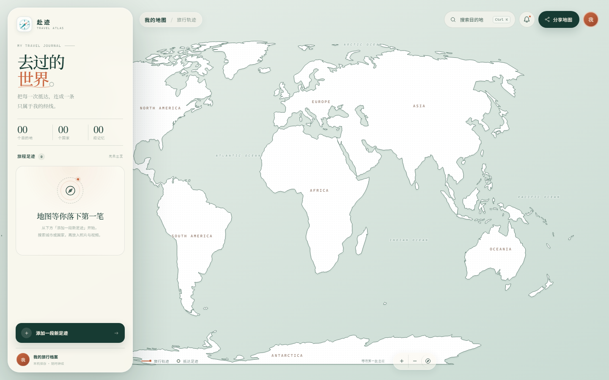

# 赴迹 · 我的旅行轨迹

一个离线可用的旅行轨迹地图。打开时是一张空白地图，不预置任何旅行记录；你可以自行搜索去过的城市，添加照片、视频和手记，再用柔和的曲线把每一次抵达连起来。



> 想分享给其他人使用？直接发 `赴迹.html` 单文件即可（双击就能用）；想要网址或装成 App 见 [DEPLOY.md](DEPLOY.md)。

## 功能

> 内置 **415 座目的地城市**（国内 191 座 + 国际 224 座），每座都配有一张本地地标风景图。

- **从空白开始**：没有示例城市、示例照片或示例路线。第一段足迹完全由你添加。
- **白色陆地地图**：采用纵向加高、横向拉伸约 10% 的 Robinson 投影，仅对高纬的西伯利亚东部做平滑横向延展；阿拉斯加西侧最外缘做了平滑收束，并删除西侧零碎小岛，减弱过长尖角与外凸；北美洲与南美洲恢复自然海岸线，取消额外的西延与斜切变形；澳大利亚采用自然海岸线，并保留以中心为轴的 10° 逆时针旋转；新西兰按参考图做了粗短化处理；塔斯马尼亚恢复为最初版的 Natural Earth 自然轮廓；苏伊士运河以一条细线与两侧海岸平滑相接，颜色与地图海岸线一致；完整显示北极、南极与所有大陆，保留原有青绿色海洋，仅陆地使用白色，并仅保留海岸线、七大洲与四大洋标注，不显示洲界、回归线或经纬网。
- **国际 / 国内两张地图**：顶部切换按钮可以在世界地图与中国地图之间自由切换。切换后地图会自动缩放到完整视图并居中。世界地图采用 Robinson 投影、白底绿海，只收录中国以外的城市；中国地图采用 Albers 投影单独绘制，只收录中国城市。两边各自保存足迹、路线与统计，互不混入。
- **随缩放出现的界线**：国内地图放大到 1.5 倍时显示实线省界，世界地图放大到 1.5 倍时显示实线国界。界线沿用加深的墨绿色，并做了陆地裁剪，不会溢到海面上。
- **按国家翻找城市**：城市清单来自《全球热门旅游城市清单》，共 326 座城市、55 个国家和地区，其中中国 102 座；国际地图下国家按英文首字母排列，展开国家后按拼音顺序列出城市；国内地图直接按拼音列出中国城市。也可以直接搜索城市中文名、英文名或拼音。
- **一趟最多 6 座城市**：添加弹窗里有 6 个空格，点城市会依次填入，至少选 1 座才能加入轨迹；同一次添加的城市算作「一段轨迹」。
- **从居住城市出发**：国内地图左侧栏可设置居住城市（城市库覆盖全国地级市），每段轨迹的第一站会从居住城市连线过去，同一段里的其余城市按顺序相连；国际地图不显示居住城市，统一从中国中部一点出发。居住城市在地图上用虚线圆点标出，名称与其他城市一致；点击它同样打开地点卡片（含该城市地标图）。
- **柔和轨迹曲线**：每段弧线可向上或向下弯，程序会自动为相近的航段选择相反方向，尽量避免两条轨迹贴在一起（交叉是允许的）。选中地点时，相邻路线高亮。
- **地点影像手记**：点击地图上的足迹，或左侧时间线中的地点，右侧展开地点卡片。可以上传照片或视频、播放视频、编辑手记、打开完整相册。
- **照片自动成为封面**：地点还没有封面时，上传的第一张照片（或视频首帧）会自动作为地图卡片和封面背景。
- **个人资料**：点击右上角头像，可以修改昵称、上传或移除自己的头像。头像会自动居中裁成圆形。
- **本机保存**：足迹、日期、手记、昵称与头像等资料保存在 `localStorage`；照片和视频文件保存在 `IndexedDB`，刷新页面后仍然保留，不上传到任何服务器。
- **旅行统计**：目的地数量、国家数量、影像数量、总里程、年份跨度都会自动更新。
- **城市地标图**：326 座城市各配一张地标风景照，选中城市时显示在添加弹窗上方；没有上传照片的地点，卡片封面也会先用这张地标图。中国城市优先选用标志性建筑、古城、山水等纯景色照片。
- **城市名称自动避让**：城市点与名称卡片只占很小一块（国内地图不显示 CN 字样，国际地图保留），邻近城市会自动把名称移到上下左右的不同方位，保证文字互不遮挡（卡片本身可以重叠），被移远的名称会有一条细引线连回城市点。
- **响应式界面**：桌面端为「时间线 + 地图 + 地点卡片」，手机端收起时间线，地点卡片变为底部抽屉。
- **无外部依赖**：地图轮廓（世界与中国）、城市数据、国旗和地标图片都随项目打包，不需要联网，也不依赖 CDN。

## 快速开始

### 方式一：直接打开

双击 `index.html`，用 Chrome 或 Edge 打开即可。所有资源都是相对路径，无需构建。

### 方式二：本地服务器（推荐）

双击 `start.bat`（Windows），脚本会在 `http://127.0.0.1:8080` 启动一个本地静态服务器，并打开浏览器。

也可以手动执行：

```bash
python -m http.server 8080
```

然后访问 `http://127.0.0.1:8080`。

> 使用本地服务器时，浏览器的存储行为最稳定。关闭 `start.bat` 打开的服务器窗口即可停止服务。

### 方式三：分享给别人使用

**最直接：发一个文件。** 根目录的 `赴迹.html` 是整站打包成的单个文件（约 20 MB，已内联样式、脚本、地图数据、地标图、国旗）：

1. 用微信 / QQ / 邮件 / U 盘把这一个文件发给对方
2. 对方双击用 Chrome / Edge 打开即可，断网也能用，不需要任何服务器或账号
3. 重新生成：`python tools/build-single.py`

**想要网址 / 装成 App：** `dist/` 是可直接部署的成品站点，已内置 PWA（应用图标、全屏启动、离线可用）：

1. 把 `dist` 文件夹拖到 <https://app.netlify.com/drop>，几十秒后得到公开网址
2. 电脑用 Chrome / Edge 打开该网址，点地址栏的「安装」；手机浏览器点「添加到主屏幕」
3. 之后它会以独立窗口 / 独立图标启动，断网也能打开

更完整的发布与分享说明见 [DEPLOY.md](DEPLOY.md)；重新打包用 `python tools/build-dist.py`；要生成给别人的压缩包时加参数：`python tools/build-dist.py --zip`。

> 提醒：每个人的记录都存在自己设备的浏览器里，把文件或网址给朋友后，对方看到的是自己的空白地图，不会看到你的行程。

## 操作说明

| 操作 | 方式 |
| --- | --- |
| 添加足迹 | 左侧底部「添加一段新足迹」、顶部搜索按钮，或 `Ctrl + K` / `⌘ + K` |
| 选择本次城市 | 在添加弹窗里点城市，依次填入下方 6 个格子，至少 1 座才能加入轨迹 |
| 设置居住城市 | 国内地图左侧栏「居住城市」→ 搜索并选择（覆盖全国 500+ 城市）；国际地图不显示该模块，默认从中国中部出发 |
| 切换国际 / 国内 | 顶部左侧的「国际 / 国内」开关；两张地图的足迹分开保存 |
| 浏览国家 | 国际地图在添加弹窗中按首字母浏览国家，点开国家查看城市，点城市显示地标图 |
| 浏览中国城市 | 国内地图在添加弹窗中直接按拼音首字母列出中国城市 |
| 搜索城市 | 直接在搜索框输入中文名、英文名或拼音 |
| 编辑个人资料 | 点击右上角头像，修改昵称、上传或移除头像 |
| 查看地点 | 点击地图上的圆点、城市标签，或左侧时间线中的地点 |
| 添加照片 / 视频 | 在地点卡片底部点击「添加照片 / 视频」，可多选文件 |
| 查看全部影像 | 地点卡片中的「查看全部」打开相册；点击影像进入全屏 |
| 编辑手记 | 点击「旅行手记」右侧的「编辑」，失焦或点击「完成」自动保存 |
| 查看邻站 | 地点卡片底部的「上一站 / 下一站」 |
| 缩放 / 平移 | 鼠标滚轮缩放、拖拽平移；右下角有缩放与回到轨迹按钮 |
| 关闭弹层 | `Esc` |

## 项目结构

```text
.
├─ index.html                 # 单页结构
├─ styles.css                 # 视觉系统、地图样式、响应式布局
├─ app.js                     # 地图投影、路线、交互、IndexedDB 存储
├─ data/
│  ├─ cities.js               # 离线城市 / 国家索引（中文、英文、拼音）
│  ├─ china-cities-extra.js   # 补充的中国城市（417 座，仅用于居住城市搜索）
│  ├─ landmarks.js            # 城市 → 地标图片映射
│  ├─ world-map.js            # 纵向加高的 Robinson 投影世界陆地轮廓
│  └─ china-map.js            # Albers 投影的中国陆地轮廓（含海南、台湾与南海诸岛）
├─ assets/
│  ├─ landmarks/              # 326 张城市地标图（jpg，760×475）
│  ├─ flags/                  # 56 面国旗（svg）
│  └─ cities/generic.svg      # 尚未上传影像时的通用地点封面
├─ tools/                     # 构建与图片处理脚本（详见「自定义」一节）
├─ assets/landmarks/           # 418 张城市地标图（每城一张，760×475）
├─ manifest.webmanifest       # PWA 清单（名称、图标、全屏启动）
├─ sw.js                      # Service Worker：离线缓存程序本体
├─ preview.png                # 桌面端空白启动页
├─ preview-mobile.png         # 移动端空白启动页
└─ start.bat                  # Windows 一键启动
```

## 自定义

- **增加目的地**：编辑 `data/cities.js` 中的 `TRAVEL_CITIES` / `TRAVEL_COUNTRIES` 即可扩展搜索库。
- **补充地标图**：把图片放进 `assets/landmarks/`，并在 `data/landmarks.js` 中增加「城市名 → 文件名」映射；`tools/` 下保留了从 docx 解析城市、抓取与压缩地标图的脚本。
- **改变主题色**：编辑 `styles.css` 顶部的 CSS 变量，例如 `--ink`、`--orange`、`--paper`。当前整套配色取自「夏日氛围色系」四色：鼠尾草绿 `#8FA88D`、浅鼠尾草 `#B4C6AE`、奶白 `#ECE8DC`、薄荷青 `#39D6C2`。海洋是浅青灰，陆地是纯鼠尾草色 #8FA88D；轨迹与未选中城市点为墨绿 `#25443B`，选中某座城市后，这一整段轨迹（含从居住城市出发的那段）都会变成薄荷青，城市点本身也变薄荷青；选中居住城市时只有它自己变薄荷青，轨迹保持不变；深青 `--accent-ink` `#0B6B62` 专用于小字号文字，保证在奶白底上的可读性。
- **清空本机记录**：在浏览器开发者工具中删除 `localStorage` 里的 `roam-atlas:v2`、`roam-atlas:v2:selected`、`roam-atlas:v2:profile`，并删除 IndexedDB 数据库 `roam-atlas-media`，刷新后会回到空白地图和默认头像。
- **大视频自动压缩**：超过 100MB 的视频会先在浏览器里重编码（最长边 1280、24fps、约 2.2Mbps 的 WebM）再保存，压缩过程按 1× 实时进行，按钮上会显示百分比；压缩失败或压缩后仍超限会提示并跳过。单文件上限 2GB。
- **查看大图**：点开影像后会自动缩放到窗口内完整显示（max-width / max-height: 100% + 等比缩放），不需要手动缩小。
- **换用本地服务器端口**：修改 `start.bat` 中的 `8080` 即可。

## 说明

- 底图轮廓使用 Natural Earth 1:110m 陆地数据，经纵向加高的 Robinson 投影生成，并切分了跨日期变更线的多边形；海洋沿用原青绿色底，陆地统一为白色，仅通过海岸线与洲洋名称表达地理信息，不绘制大洲分界。
- 建议使用支持 `dialog`、`IndexedDB`、`SVG` 和 `backdrop-filter` 的现代浏览器（Chrome / Edge / Safari 最新版）。
